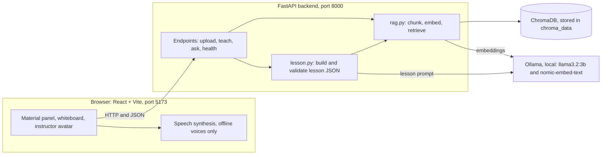
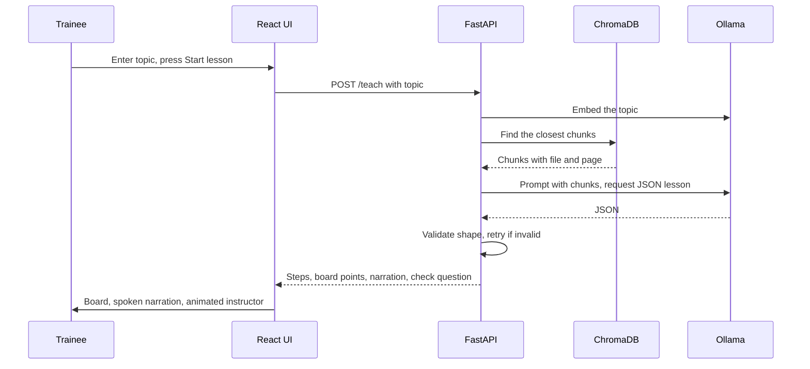

# AI Training Assistant

A fully offline AI tutor that teaches from uploaded training material. An instructor uploads PDFs; the system indexes them, then teaches any topic from that material as a step-by-step lesson on a digital whiteboard, narrated aloud by an animated instructor, and ends with a check question.

Everything runs on one laptop: local language model, local embeddings, local vector database, offline voice. **No cloud APIs, no accounts, no data leaves the machine.**

<!-- Add a screenshot: save it as docs/screenshot.png and uncomment the next line -->
<!--  -->

## Why this exists

Defence and other secure training environments cannot send course material to a public chatbot. This project shows that a grounded, teaching-style assistant is possible entirely inside a closed system:

- Answers come **only** from the uploaded material, with file and page citations.
- If the material does not cover a topic, the tutor says so instead of inventing a lesson.
- It teaches (board, narration, quiz) instead of only replying in chat.

## Features

- Upload PDF training material through the web interface
- Retrieval-Augmented Generation (RAG) over all uploaded PDFs, with source file and page numbers
- Lesson generation: the LLM returns a structured JSON lesson (steps, whiteboard points, narration, check question), validated before use
- Three-panel classroom screen: material panel, whiteboard, animated instructor
- Spoken narration using offline system voices only, with the avatar's mouth driven by word timing
- Refusal behaviour: `found: false` when the material does not cover the topic

## Architecture



### What happens when a lesson is requested



### Ingestion

1. `pypdf` extracts text page by page.
2. Each page is split into overlapping chunks (800 characters, 150 overlap) so ideas are not cut at chunk edges.
3. Each chunk is embedded with `nomic-embed-text` through Ollama.
4. Chunks are stored in ChromaDB with their source file name and page number.

### Lesson format

`POST /teach` returns JSON the whiteboard can render directly:

```json
{
  "found": true,
  "topic": "example topic",
  "steps": [
    {
      "title": "Step title",
      "board": ["short point one", "short point two"],
      "narration": "What the instructor says for this step.",
      "source_page": 3
    }
  ],
  "check_question": { "question": "…", "answer": "…" }
}
```

`title` and `board` go on the whiteboard, `narration` is spoken, `check_question` is the end-of-lesson quiz, and `source_page` is the citation.

## Tech stack

| Layer | Tools |
|---|---|
| Language model | Llama 3.2 (3B) through Ollama |
| Embeddings | nomic-embed-text through Ollama |
| Vector database | ChromaDB (persistent, local) |
| PDF parsing | pypdf |
| Backend | Python, FastAPI, Uvicorn, Pydantic |
| Frontend | React, Vite |
| Voice | Browser speech synthesis, restricted to offline voices |

## Project structure

```
ai-training-assistant/
├── backend/
│   ├── main.py        API endpoints
│   ├── rag.py         chunking, embedding, retrieval, question answering
│   └── lesson.py      lesson generation and validation
├── frontend/
│   └── src/           React app (App.jsx, Avatar.jsx, styles)
├── step1_rag.py       original command-line version of the RAG pipeline
├── requirements.txt
└── README.md
```

`chroma_data/` and `uploads/` are created at runtime and are git-ignored.

## Setup

**Prerequisites:** Python 3.10+, Node.js (LTS), [Ollama](https://ollama.com), and a Chromium-based browser (Chrome or Edge).

1. **Download the models** (once):
   ```
   ollama pull llama3.2:3b
   ollama pull nomic-embed-text
   ```
   On a laptop with 8 GB RAM or less, use `llama3.2:1b` and change `LLM_MODEL` in `backend/rag.py`.

2. **Backend:**
   ```
   python -m venv venv
   venv\Scripts\activate          (macOS/Linux: source venv/bin/activate)
   pip install -r requirements.txt
   cd backend
   python -m uvicorn main:app --reload
   ```
   The API runs at `http://127.0.0.1:8000`. Interactive API docs are at `/docs`.

3. **Frontend** (in a second terminal):
   ```
   cd frontend
   npm install
   npm run dev
   ```
   Open `http://localhost:5173`.

4. Upload a text-based PDF, type a topic from it, and press **Start lesson**.

Make sure the Ollama app is running before you start. For spoken narration, an offline system voice must be installed.

### Running without internet

Internet is needed **only for setup**: `pip install`, `npm install`, and downloading the two models with `ollama pull`. After that, disconnect from the internet and everything still works. `localhost` is the computer talking to itself, so the browser, the API, Ollama and the database all communicate without any network connection. Anonymous ChromaDB telemetry is switched off in `backend/rag.py`.

## Design decisions

- **Fully local.** Local models, local database, offline voices. This is the central requirement for secure training environments, so no cloud service is used anywhere.
- **RAG instead of fine-tuning.** Training material can be added or removed instantly without retraining, and every answer can point to its source page.
- **Strict grounding.** The prompt allows only the retrieved material, and the system returns `found: false` when the topic is not covered.
- **Structured JSON with validation.** Free text cannot drive a whiteboard. The model returns JSON, Pydantic checks its shape, and the request is retried when the shape is wrong. Low temperature keeps the structure consistent.
- **Offline voices only.** The voice list is filtered to local voices. Some browser voices are online services and are excluded on purpose.
- **Plain 2D avatar.** A lightweight SVG avatar was chosen over a 3D model to keep the project reliable and quick to run on a laptop.
- **Separation of concerns.** `rag.py` holds the AI logic, `main.py` only the web layer, and `lesson.py` the teaching format, so each can change independently.

## Limitations

- **No speech input.** Offline speech recognition (Whisper) depends on PyTorch, which was unreliable on the Windows ARM64 development machine, and browser speech recognition sends audio to online servers, which would break the offline guarantee.
- **Lip-sync follows word timing, not the audio signal.** The browser does not expose the audio from speech synthesis, so the mouth opens on each spoken word rather than on true loudness.
- **Small model.** Answer and lesson quality is limited by a 3B model, and the first lesson can take up to a minute while the model loads. Speed depends on the laptop.
- **Single user, no roles.** There are no logins, so there is no separation between an instructor who manages material and a trainee who learns from it.
- **One shared pool of documents.** All PDFs are indexed together, so a topic can draw on any uploaded file.
- **English-focused retrieval.** `nomic-embed-text` works best on English text, so topics should be typed in English.


## Roadmap

- Document manager: list uploaded files, delete a file
- Instructor and trainee roles
- Multi-user deployment on a closed local network: run the backend on one server machine (`--host 0.0.0.0`), point the frontend at its address, and let trainees connect from their own browsers, still with no internet
- Multilingual lessons with a larger local model
- Offline speech input
- OCR for scanned PDFs
- Lip-sync driven by the actual audio signal

## Notes

Developed and tested with Python, Ollama and Node.js on a laptop with no GPU. Llama 3.2 is used under its community license. Sample PDFs used for testing are public documents; none are included in this repository.
